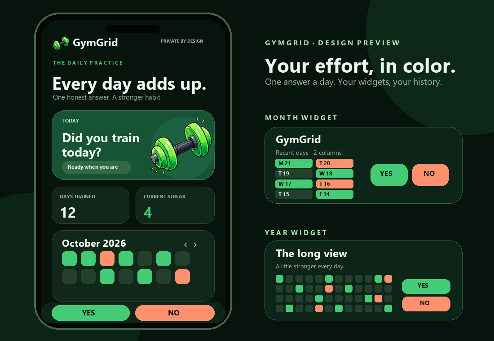

# GymGrid

  

An open source Android workout calendar inspired by contribution grids. Answer **Yes** or **No** in the app or from your home screen widget. Yes turns a day green; No turns it coral. Your answers stay on your phone.

## Preview

The preview illustrates the app and its widgets. The dumbbell appears in the app and launcher icon.

## Features

- Yes and No actions directly on both home screen widgets
- Green Yes days, coral No days, and darker unanswered days
- A responsive small widget with two large action tiles
- A two-column view of your eight most recent days on the month widget
- A playful dumbbell motion and color pulse when you answer in the app
- One tap to change a past day in the app
- Monthly calendar and a rolling year grid
- Current streak and total logged days
- Compact month widget and larger year widget
- Data stored locally on your device, with no account or network access

## Install on a Samsung Galaxy S25

1. Open the [v0.3.0 release](https://github.com/Aryansharma28/gymgrid/releases/tag/v0.3.0) on your phone and tap **GymGrid-v0.3.0.apk** under **Assets**.
2. Open the download in Samsung Internet, Chrome, or **My Files → Downloads** and tap **Install**.
3. If Samsung asks, allow **Install unknown apps** for the app you opened the APK with. You can find this under **Settings → Security and privacy → More security settings → Install unknown apps**. If **Auto Blocker** interrupts the install, go to **Settings → Security and privacy → Auto Blocker**, switch it off for the installation, then turn it back on afterward.
4. Open GymGrid once. Long press an empty spot on the home screen, tap **Widgets**, choose **GymGrid · Month** or **GymGrid · Year**, then tap **Add**. You can resize the widget by long pressing it and dragging a corner.
5. Tap **Yes** or **No** directly on the widget each day. The app holds your monthly and yearly history.

## Install on another Android phone

Download **GymGrid-v0.3.0.apk** from the same release on an Android 8.0 or newer phone. Open the APK in your browser or file manager, allow that app to install unknown apps if prompted, and tap **Install**. Then long press the home screen, open **Widgets**, and add a GymGrid widget. Tap its calendar to open the app and edit past days.

If you already installed v0.2.0, install v0.3.0 over it to keep your locally saved days. If you installed the early v0.1.0 debug preview, uninstall it before installing v0.3.0 because the signing key changed. Uninstalling v0.1.0 removes its locally saved days.

## Use the app and widgets

1. Open **GymGrid** from your app drawer to see today's answer, your month calendar, yearly grid, and streak. Use the big **Yes, I trained** or **No, not today** buttons at the bottom to answer. The dumbbell and card animate when you tap.
2. To change an earlier day, tap its square in the monthly calendar. Tap again to switch between Yes and No. Use the arrows beside the month name to browse other months. Future days cannot be marked.
3. To add a widget on Samsung, long press an empty spot on the home screen, tap **Widgets**, search for **GymGrid**, choose **Month** or **Year**, and tap **Add**.
4. Tap **Yes** or **No** on the widget to answer for today without opening the app. Green means Yes; coral means No; dark means unanswered. Tap the widget's title, status, or grid to open the full app.
5. To resize it, long press the widget and drag a resize handle. At the smallest height it shows two large Yes/No tiles. At a medium size it shows eight recent days in two columns. A wide widget shows the full month or year grid.

If the old app showed **GymGrid keeps stopping**, install v0.3.0 over v0.2.0. The startup window handling was corrected in this release. You do not need to uninstall v0.2.0.

## Build

The project uses Android Gradle Plugin 8.9.2, Gradle 8.11.1, Java 17, and Android SDK 35. Open this project in Android Studio and run the `app` configuration on your device, or run `./gradlew assembleDebug` (`gradlew.bat assembleDebug` on Windows). The output is `app/build/outputs/apk/debug/app-debug.apk`. Public downloads use a separately signed release APK.

## Privacy

Yes and No answers are saved in the app's private local storage. The app requests no permissions and does not send data anywhere. Uninstalling the app removes the answers.

## Contributing

Issues and pull requests are welcome. Please keep the app small, accessible, and useful without an account.

## License

MIT. See [LICENSE](LICENSE).
